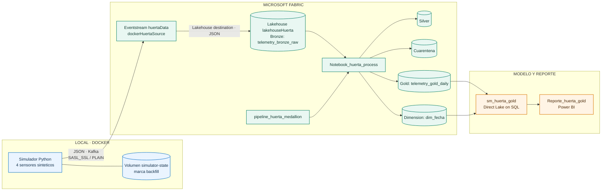
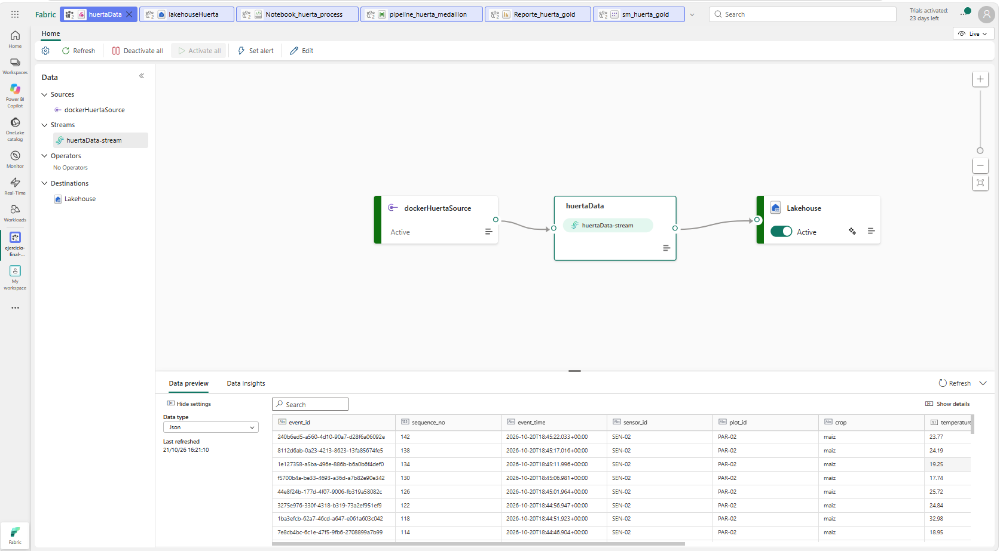
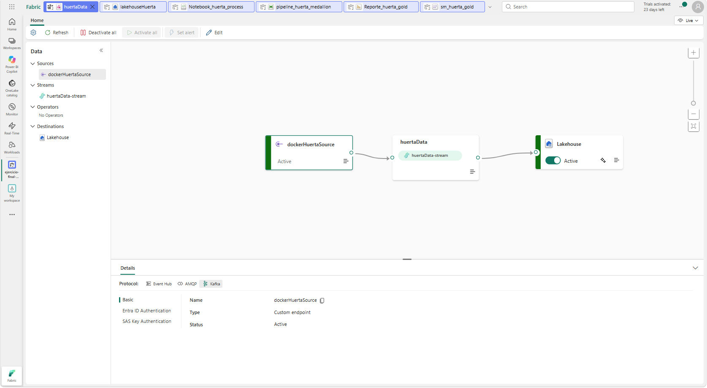
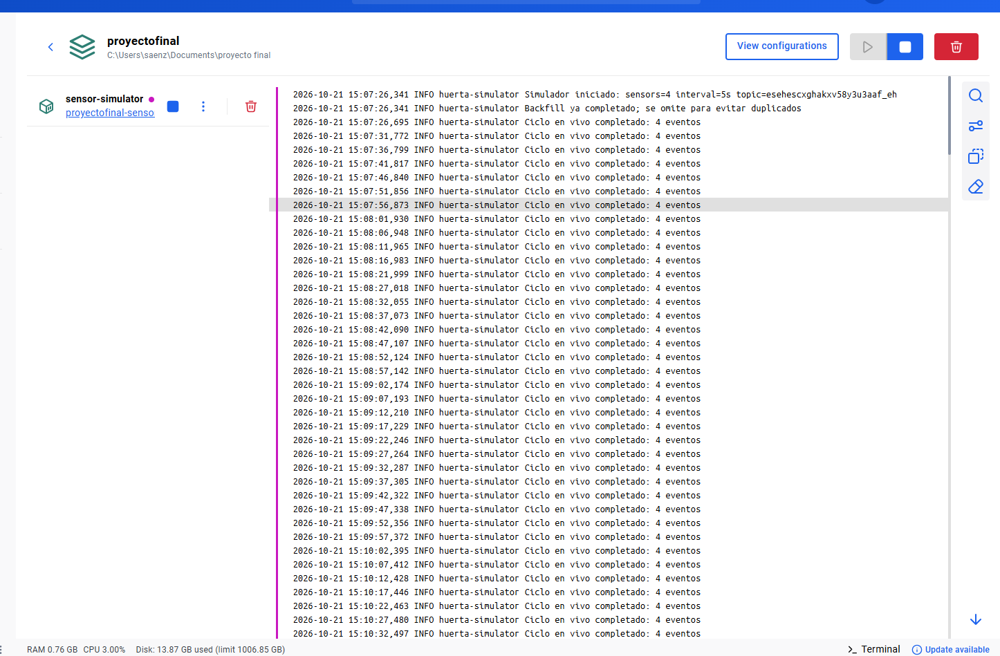
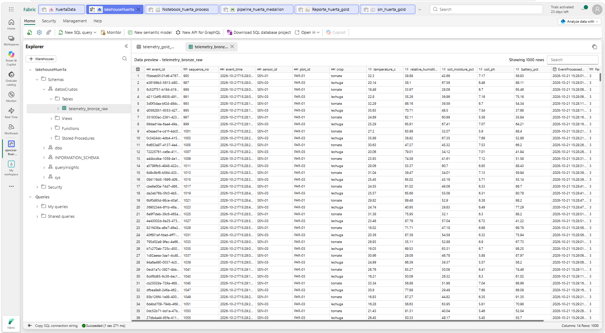
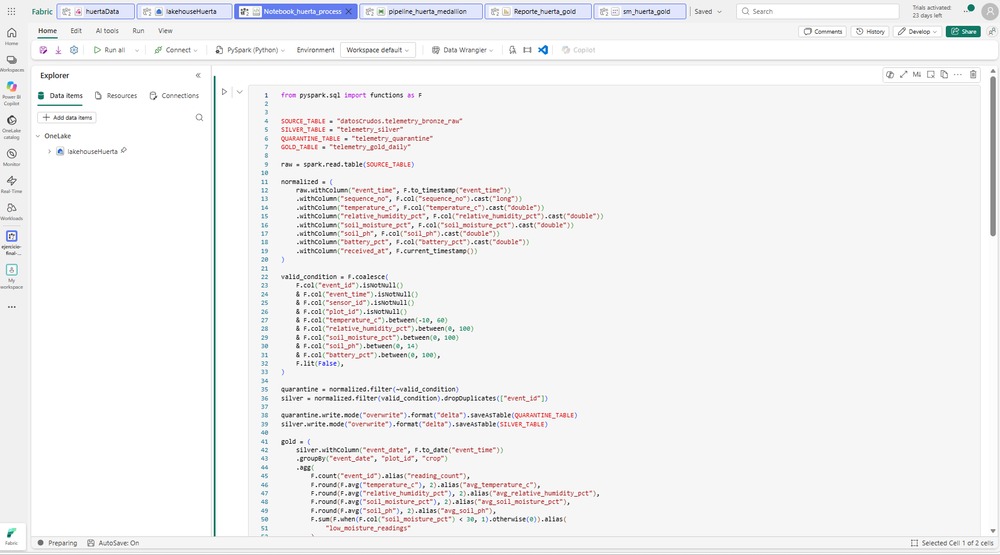
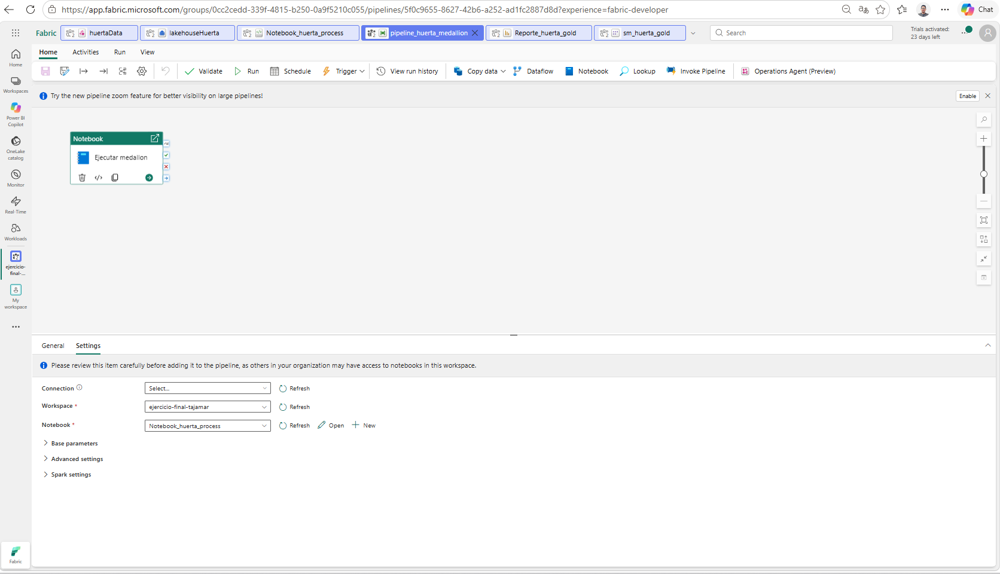
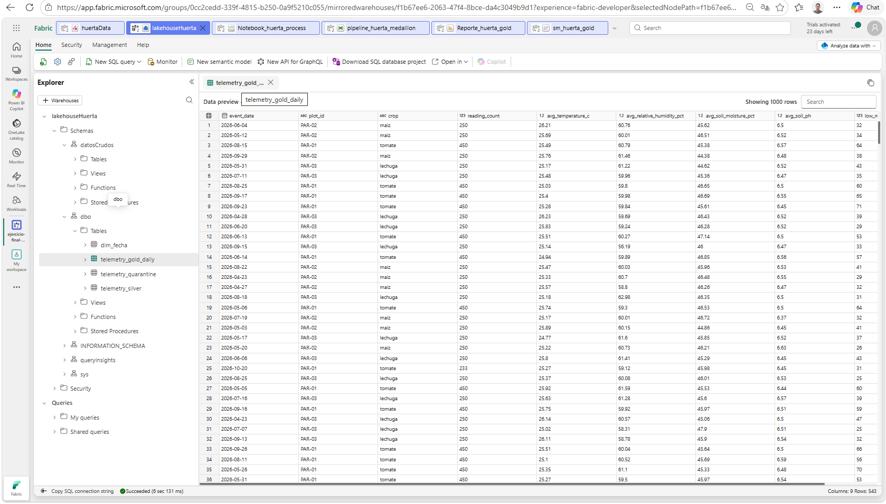
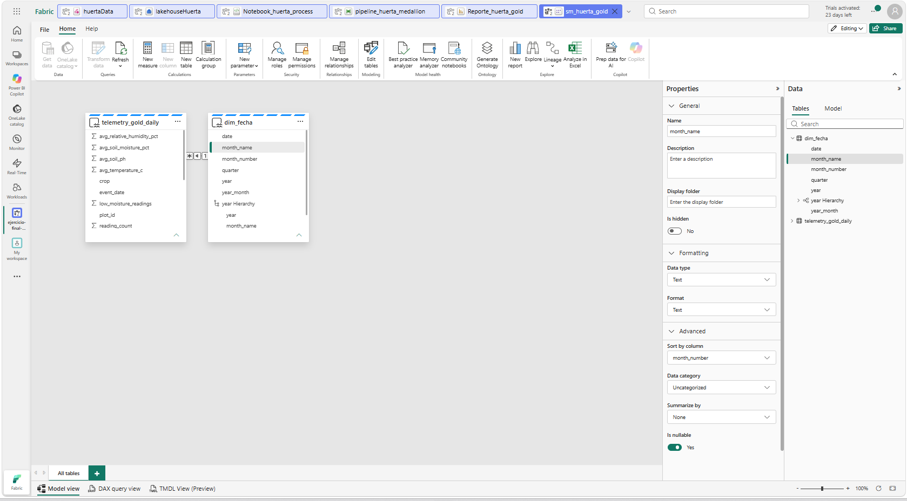
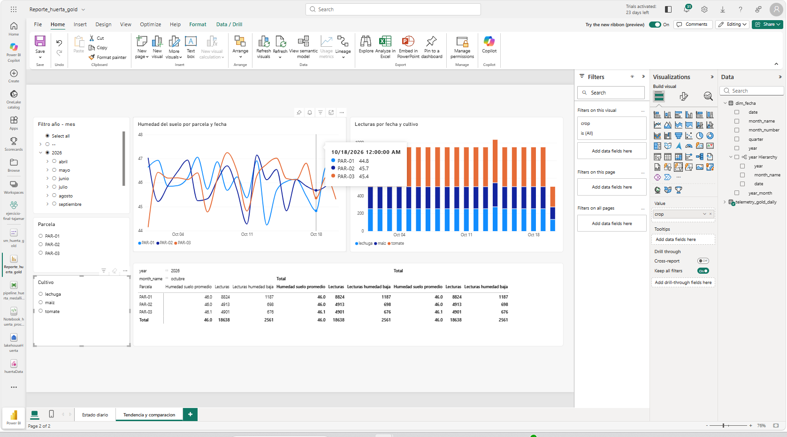

<div align="center">

# Huerta IoT

### Del sensor simulado al analisis medallion en Microsoft Fabric

Simula telemetria de una huerta con Docker, ingresa eventos Kafka en Fabric y prepara datos analiticos listos para Power BI.

<p>
  
  
  
  
</p>

**Proyecto educativo reproducible** · Eventstream · Lakehouse · Notebook · Pipeline · Power BI

</div>

> **Modelo de ingesta:** no hay una API HTTP/REST local. El proceso Python publica eventos Kafka directamente al **Custom endpoint** de Fabric. No se usa ngrok, IaC ni automatizacion de Fabric; los elementos de la plataforma se crean desde su interfaz.

| Flujo | Resumen |
|---|---|
| **Entrada** | 180.000 lecturas historicas sinteticas y telemetria en vivo desde Docker. |
| **Ingesta** | Kafka con `SASL_SSL` hacia Eventstream `huertaData`. |
| **Almacenamiento** | Lakehouse `lakehouseHuerta`, Bronze en OneLake. |
| **Transformacion** | Pipeline de Fabric que ejecuta Spark para Silver, cuarentena, Gold y calendario. |
| **Consumo** | Modelo semantico Direct Lake on SQL y reporte Power BI. |

## Inicio rapido

1. Crea en Fabric el Eventstream, el destino Lakehouse y copia los datos Kafka a `.env`.
2. Configura `KAFKA_BOOTSTRAP_SERVERS`, `KAFKA_TOPIC` y `KAFKA_CONNECTION_STRING` en el archivo local `.env`.
3. Inicia el productor:

   ```powershell
   docker compose up --build -d
   docker compose logs -f sensor-simulator
   ```

4. Espera `Backfill completado y marcado: 180000 eventos`; luego ejecuta `pipeline_huerta_medallion` desde Fabric.

La guia completa de creacion manual, reporte y capturas esta mas abajo. **Nunca subas `.env` ni capturas con claves visibles.**

## Tabla de contenidos

- [Arquitectura](#arquitectura)
- [Componentes](#componentes)
- [Requisitos](#requisitos)
- [Configuracion de Fabric](#configuracion-de-fabric)
- [Configuracion de Docker y Kafka](#configuracion-de-docker-y-kafka)
- [Ejecucion del productor](#ejecucion-del-productor)
- [Capas medallion y pipeline](#capas-medallion-y-pipeline)
- [Modelo semantico y reporte](#modelo-semantico-y-reporte)
- [Capturas para documentar](#capturas-para-documentar)
- [Seguridad y limites](#seguridad-y-limites)
- [Solucion de problemas](#solucion-de-problemas)
- [Estructura del repositorio](#estructura-del-repositorio)

## Arquitectura



> **Recorrido:** simular → publicar → aterrizar en Bronze → validar y transformar → agregar en Gold → explorar en Power BI.

## Componentes

| Componente | Responsabilidad |
|---|---|
| `app/` | Genera y publica eventos JSON con `confluent-kafka`. No expone HTTP. |
| Docker Compose | Construye y ejecuta el productor; conserva el marcador del backfill en un volumen. |
| Eventstream `huertaData` | Recibe Kafka mediante la fuente `dockerHuertaSource` y escribe en el Lakehouse. |
| Lakehouse `lakehouseHuerta` | Conserva Bronze en `datosCrudos.telemetry_bronze_raw` y las tablas derivadas en el esquema `dbo`. |
| `fabric/medallion.py` | Codigo fuente que se copia a una celda PySpark del notebook de Fabric. |
| `Notebook_huerta_process` | Ejecuta validacion, deduplicacion, agregacion diaria y dimension calendario. |
| `pipeline_huerta_medallion` | Orquesta la ejecucion del notebook desde Fabric. |
| `sm_huerta_gold` | Modelo Direct Lake on SQL sobre Gold y `dim_fecha`. |
| `Reporte_huerta_gold` | Reporte Power BI para indicadores, comparaciones y tendencias. |

Los nombres anteriores son los usados en esta implementacion. Al replicar, puedes cambiarlos; si lo haces, actualiza las referencias del notebook y los pasos correspondientes.

## Requisitos

- Windows con Docker Desktop y Docker Compose v2, o un sistema compatible con Docker.
- Acceso a Microsoft Fabric y permiso para crear Eventstreams, Lakehouses, notebooks, pipelines y modelos semanticos en un workspace con capacidad Fabric o trial activa.
- Una fuente **Custom endpoint** publicada en Eventstream.
- Python no es requisito para ejecutar el productor en el host; se ejecuta dentro de Docker.

## Configuracion de Fabric

Todos los elementos de esta seccion se crean manualmente desde la interfaz de Fabric; este proyecto no usa Fabric REST API ni IaC.

### 1. Workspace y Eventstream

1. Crea o abre un workspace asignado a capacidad Fabric/trial.
2. Crea un **Eventstream** llamado `huertaData`. Deja desactivada la experiencia **Schema-aware Eventstream (Preview)** para seguir el flujo estandar.
3. Agrega una fuente **Custom endpoint** y nombra la fuente `dockerHuertaSource`. Deja **Schema association / Activate** desactivado.
4. Publica el Eventstream. La fuente debe quedar activa.
5. Selecciona `dockerHuertaSource`, abre los detalles del protocolo **Kafka** y la seccion **SAS Key Authentication**. Copia localmente el bootstrap server, topic y una connection string completa.

Configuracion Kafka utilizada por el productor:

| Propiedad | Valor |
|---|---|
| Seguridad | `SASL_SSL` |
| Mecanismo SASL | `PLAIN` |
| Usuario SASL | `$ConnectionString` |
| Contrasena SASL | Connection string completa primaria o secundaria de Fabric |

### 2. Lakehouse y destino Bronze

1. En `huertaData`, agrega **Destination > Lakehouse**.
2. Selecciona o crea `lakehouseHuerta`.
3. Configura el esquema/tabla de destino `datosCrudos.telemetry_bronze_raw` y el formato de entrada **JSON**.
4. Publica el Eventstream y confirma que la fuente y el destino esten activos.

El Eventstream hace la ingesta. No agregues una actividad Copy al pipeline para volver a copiar los mismos mensajes.

### 3. Notebook y pipeline

1. Crea `Notebook_huerta_process` en el workspace y adjunta `lakehouseHuerta` como Lakehouse predeterminado.
2. Copia el contenido completo de [`fabric/medallion.py`](fabric/medallion.py) en una celda Python del notebook.
3. Ejecuta la celda despues de que Bronze tenga datos. El notebook escribe Silver, cuarentena, Gold y `dim_fecha` en el esquema predeterminado `dbo`.
4. Crea el pipeline `pipeline_huerta_medallion`.
5. Agrega una sola actividad **Notebook**, selecciona `Notebook_huerta_process`, guarda y ejecuta el pipeline.
6. Comprueba que la actividad termine en **Succeeded** y que existan las tablas de salida en `lakehouseHuerta`.

El notebook hace `overwrite` de sus tablas para que la practica sea repetible. Para un sistema real con ejecuciones incrementales, sustituye ese modo por `MERGE`/upsert y define una estrategia de checkpoint.

## Configuracion de Docker y Kafka

### Variables de entorno

El archivo `.env.example` documenta los valores no secretos. Al clonar el proyecto, crea `.env` sin sobrescribir uno existente:

```powershell
if (-not (Test-Path .env)) { Copy-Item .env.example .env }
```

Completa estas tres variables con los valores que muestra **Kafka > SAS Key Authentication** en Fabric:

| Variable | Contenido |
|---|---|
| `KAFKA_BOOTSTRAP_SERVERS` | Valor **Bootstrap server** |
| `KAFKA_TOPIC` | Valor **Topic name** |
| `KAFKA_CONNECTION_STRING` | **Connection string-primary key** o **secondary key** completa |

La connection string completa empieza con `Endpoint=sb://` e incluye `SharedAccessKeyName`, `SharedAccessKey` y `EntityPath`. No pegues solo el campo `Primary key`.

Variables opcionales de simulacion:

| Variable | Default | Descripcion |
|---|---:|---|
| `SIM_INTERVAL_SECONDS` | `5` | Pausa entre ciclos de telemetria en vivo. |
| `SENSOR_COUNT` | `4` | Sensores simulados por ciclo. |
| `ANOMALY_EVERY_N_EVENTS` | `20` | Cada cuantos eventos se genera una humedad invalida; usa `0` para desactivar. |
| `BACKFILL_DAYS` | `180` | Dias historicos antes de continuar con telemetria en vivo; `0` omite el backfill. |
| `BACKFILL_RECORDS_PER_DAY` | `1000` | Eventos sinteticos por dia historico. |

### Dockerfile y Compose

`Dockerfile` parte de `python:3.12-slim`, instala `confluent-kafka==2.10.1`, copia `app/` y ejecuta con un usuario no root. `compose.yaml` publica un solo servicio, `sensor-simulator`, y monta el volumen nombrado `simulator-state` en `/data` para persistir el marcador del backfill.

## Ejecucion del productor

Desde la carpeta raiz del proyecto:

```powershell
docker compose config --quiet
docker compose up --build -d
docker compose logs -f sensor-simulator
```

En los logs, el backfill informa el avance cada 10.000 mensajes y al final muestra `Backfill completado y marcado: 180000 eventos`. Despues veras `Ciclo en vivo completado` y eventos entregados. Comprueba el estado con:

```powershell
docker compose ps
docker compose logs --tail 50 sensor-simulator
```

Para detener el servicio sin borrar el marcador:

```powershell
docker compose stop sensor-simulator
```

Para reanudarlo:

```powershell
docker compose start sensor-simulator
```

`docker compose down` conserva el volumen. Evita `docker compose down -v`: elimina el marcador local y hara que el contenedor vuelva a publicar los 180.000 eventos historicos. Si el proceso se detiene antes de completar el backfill, no se guarda el marcador; al reiniciar reintentara desde el principio. Los IDs historicos son deterministas y Silver deduplica por `event_id`, pero Bronze puede contener repeticiones de los eventos publicados antes de la interrupcion.

### Historico y flujo en vivo

Con los valores predeterminados, el primer inicio genera 180 dias completos desde hace 180 dias hasta ayer UTC, con 1.000 eventos por dia: **180.000 mensajes**. Cada dia se distribuye a lo largo de sus 24 horas. Una vez completado el historico, el productor empieza a generar lecturas con fecha UTC actual, una por sensor cada cinco segundos.

Cada vigesimo evento tiene `soil_moisture_pct=125.0` para probar cuarentena. En un backfill completo son aproximadamente 9.000 registros fuera de rango y 171.000 validos; el resultado exacto depende de los limites de calidad vigentes en el notebook. La simulacion y los umbrales son didacticos, no recomendaciones agronomicas.

El volumen historico puede consumir capacidad de Eventstream/Lakehouse. Espera a que el backfill termine antes de ejecutar el notebook; para una primera prueba pequena puedes configurar `BACKFILL_DAYS=0` o reducir `BACKFILL_RECORDS_PER_DAY` en `.env`.

## Contrato de evento

Cada mensaje Kafka es un objeto JSON independiente. Los campos `event_id`, `event_time`, `sensor_id` y `plot_id` forman parte del contrato y deben conservarse:

```json
{
  "event_id": "hist-20260423-0001",
  "sequence_no": 1,
  "event_time": "2026-04-23T00:00:00.000+00:00",
  "sensor_id": "SEN-01",
  "plot_id": "PAR-01",
  "crop": "tomate",
  "temperature_c": 24.1,
  "relative_humidity_pct": 61.3,
  "soil_moisture_pct": 42.7,
  "soil_ph": 6.4,
  "battery_pct": 91.0
}
```

El archivo [`data/sample_readings.jsonl`](data/sample_readings.jsonl) contiene 20 eventos de ejemplo para revisar el contrato; uno es intencionalmente invalido.

## Capas medallion y pipeline

El notebook de [`fabric/medallion.py`](fabric/medallion.py) lee `datosCrudos.telemetry_bronze_raw`, convierte tipos y agrega `received_at`.

| Tabla Lakehouse | Capa | Contenido |
|---|---|---|
| `datosCrudos.telemetry_bronze_raw` | Bronze | Eventos JSON originales escritos por Eventstream. |
| `dbo.telemetry_silver` | Silver | Lecturas tipadas, dentro de rango y deduplicadas por `event_id`. |
| `dbo.telemetry_quarantine` | Cuarentena | Eventos nulos o fuera de los rangos de calidad. |
| `dbo.telemetry_gold_daily` | Gold | Conteos, promedios diarios y lecturas de humedad baja agrupadas por fecha, parcela y cultivo. |
| `dbo.dim_fecha` | Dimensional | Calendario fisico para jerarquia Ano > Mes > Fecha y filtros por periodo. |

Los rangos de validacion actuales son: temperatura de -10 a 60 C, humedad relativa y del suelo de 0 a 100%, pH de 0 a 14 y bateria de 0 a 100%. Gold define humedad baja como menos de 30% para esta practica.

### Relacion y orden de meses

En `sm_huerta_gold`, agrega `dbo.dim_fecha` junto con `dbo.telemetry_gold_daily` y crea la relacion activa uno-a-varios `dim_fecha[date]` -> `telemetry_gold_daily[event_date]`. En el modelo, ordena `dim_fecha[month_name]` por `dim_fecha[month_number]`; asi los meses aparecen enero, febrero, marzo y no alfabeticamente. Direct Lake on SQL no admite tablas calculadas DAX que dependan de tablas Direct Lake, por eso `dim_fecha` se crea fisicamente en el notebook.

El proceso de medallion es batch: el Eventstream ingiere continuamente; el pipeline vuelve a ejecutar el notebook cuando lo inicias o lo programas. Para la practica, ejecuta el pipeline despues de que termine el historico. Si la capacidad Spark devuelve HTTP 430, no pulses Run repetidamente: revisa jobs activos/encolados en Monitoring y espera a que haya capacidad disponible.

## Modelo semantico y reporte

El modelo `sm_huerta_gold` se creo desde el SQL analytics endpoint del Lakehouse en modo **Direct Lake on SQL**. Incluye `telemetry_gold_daily` y `dim_fecha`; la dimension permite filtrar y agrupar por ano, mes y fecha.

El reporte `Reporte_huerta_gold` utiliza medidas ponderadas por `reading_count` para que grupos con distintos volumenes no sesguen los promedios. La guia completa de medidas DAX, visuales, filtros mensuales y paginas esta en [`fabric/reportes.md`](fabric/reportes.md).

La propuesta contiene:

- Pagina **Estado diario**: tarjetas de lecturas y condiciones promedio, humedad por parcela, lecturas de humedad baja y tabla de detalle.
- Pagina **Tendencias**: humedad por parcela y fecha, volumen de lecturas por cultivo y matriz comparativa.
- Segmentadores de ano/mes, parcela y cultivo, con el filtro mensual sincronizado entre paginas.

## Galeria del proyecto

Las capturas reales se guardan en `docs/images/` y se presentan aqui en el orden del recorrido, desde la ingesta hasta el reporte. Las claves Kafka no aparecen en las capturas.

### Ingesta

<table>
  <tr>
    <td width="50%">
      
      <p><strong>01 · Eventstream y destino</strong><br>Fuente Kafka y destino Lakehouse publicados; la vista previa muestra eventos Bronze.</p>
    </td>
    <td width="50%">
      
      <p><strong>02 · Conexion Kafka</strong><br>Custom endpoint activo con el protocolo Kafka seleccionado; no se muestran credenciales.</p>
    </td>
  </tr>
  <tr>
    <td width="50%">
      
      <p><strong>03 · Productor Docker</strong><br>Backfill omitido por marcador persistente y ciclos de telemetria en vivo.</p>
    </td>
    <td width="50%">
      
      <p><strong>04 · Tabla Bronze</strong><br>Lecturas JSON almacenadas en `datosCrudos.telemetry_bronze_raw`.</p>
    </td>
  </tr>
</table>

### Procesamiento

<table>
  <tr>
    <td width="50%">
      
      <p><strong>05 · Notebook medallion</strong><br>Notebook PySpark que valida, deduplica y genera las capas analiticas.</p>
    </td>
    <td width="50%">
      
      <p><strong>06 · Pipeline</strong><br>La actividad `Ejecutar medallon` orquesta el notebook.</p>
    </td>
  </tr>
</table>

### Modelo y analitica

<table>
  <tr>
    <td width="50%">
      
      <p><strong>07 · Gold y calendario</strong><br>Tabla agregada `telemetry_gold_daily` y dimension fisica `dim_fecha`.</p>
    </td>
    <td width="50%">
      
      <p><strong>08 · Modelo semantico</strong><br>Relacion activa entre `dim_fecha` y la tabla Gold.</p>
    </td>
  </tr>
  <tr>
    <td width="50%">
      
      <p><strong>09 · Reporte Power BI</strong><br>Tendencias, volumen por cultivo y segmentadores por ano, mes, parcela y cultivo.</p>
    </td>
    <td width="50%"></td>
  </tr>
</table>

Para agregar o sustituir una captura, coloca el archivo en `docs/images/` y actualiza su referencia en esta galeria. La guia de seguridad esta en [`docs/images/README.md`](docs/images/README.md).

## Seguridad y limites

- `.env` esta ignorado por Git. Versiona `.env.example`, que deja en blanco las tres variables de conexion.
- El contenedor solo inicia conexiones salientes al endpoint de Fabric; no publica un puerto HTTP.
- El volumen local conserva el marcador, no sustituye la persistencia de datos en Fabric.
- Los eventos, cultivos, mediciones, umbrales y conclusiones son sinteticos y educativos.
- No se crean workspace, Eventstream, Lakehouse, notebook, pipeline ni reportes mediante API o IaC.

## Solucion de problemas

| Sintoma | Comprobacion |
|---|---|
| Error de autenticacion Kafka | Usa la connection string SAS completa, no `Primary key` aislada; confirma `$ConnectionString`, topic y bootstrap server. |
| Compose indica que falta una variable | Completa `KAFKA_BOOTSTRAP_SERVERS`, `KAFKA_TOPIC` y `KAFKA_CONNECTION_STRING` en `.env`. |
| No aparecen eventos | Confirma que Eventstream este publicado/activo, que el topic coincida y revisa `docker compose logs --tail 50 sensor-simulator`. |
| Bronze aun no muestra filas | Revisa Data preview del Eventstream y espera a que el destino escriba el lote. |
| Notebook devuelve HTTP 430 | Es limite de capacidad Spark. Evita ejecuciones repetidas; revisa Monitoring, cancela jobs obsoletos y reintenta cuando se libere capacidad. |
| Meses aparecen alfabeticamente | Ordena `dim_fecha[month_name]` por `dim_fecha[month_number]` en el modelo. |
| Reporte no responde al filtro de mes | Revisa que exista la relacion activa `dim_fecha[date]` a Gold `[event_date]` y que el segmentador use la dimension. |

## Estructura del repositorio

```text
.
|-- .github/
|   `-- copilot-instructions.md
|-- app/
|   `-- __main__.py           # Productor Kafka y generador de eventos
|-- data/
|   `-- sample_readings.jsonl # 20 eventos de muestra
|-- docs/
|   `-- images/
|       |-- 01-workspace-eventstream.png
|       |-- 03-kafka-connection-redacted.png
|       |-- 05-docker-logs.png
|       |-- 06-bronze-table.png
|       |-- 07-notebook-medallion.png
|       |-- 08-pipeline-success.png
|       |-- 09-gold-and-calendar.png
|       |-- 10-semantic-model.png
|       |-- 11-power-bi-report.png
|       `-- README.md         # Seguridad de capturas
|-- fabric/
|   |-- medallion.py          # Silver, cuarentena, Gold y dim_fecha
|   `-- reportes.md           # Medidas DAX y diseno de paginas
|-- tests/
|   `-- test_simulator.py     # Pruebas del backfill y del contrato
|-- .env.example              # Variables configurables, sin secretos
|-- .gitignore
|-- compose.yaml
|-- Dockerfile
|-- requirements.txt
`-- README.md
```

`.env` existe solo en la copia local, esta ignorado por Git y no forma parte del repositorio publico.

## Referencias

- [Agregar una fuente Custom endpoint](https://learn.microsoft.com/fabric/real-time-intelligence/event-streams/add-source-custom-app)
- [Enviar eventos con Kafka a Eventstream](https://learn.microsoft.com/fabric/real-time-intelligence/event-streams/stream-consume-events-use-kafka-endpoint)
- [Destinos de Eventstream](https://learn.microsoft.com/fabric/real-time-intelligence/event-streams/overview)
- [Limitaciones de Direct Lake](https://learn.microsoft.com/fabric/fundamentals/direct-lake-overview)
- [Ordenar una columna por otra en Power BI](https://learn.microsoft.com/power-bi/create-reports/desktop-sort-by-column)